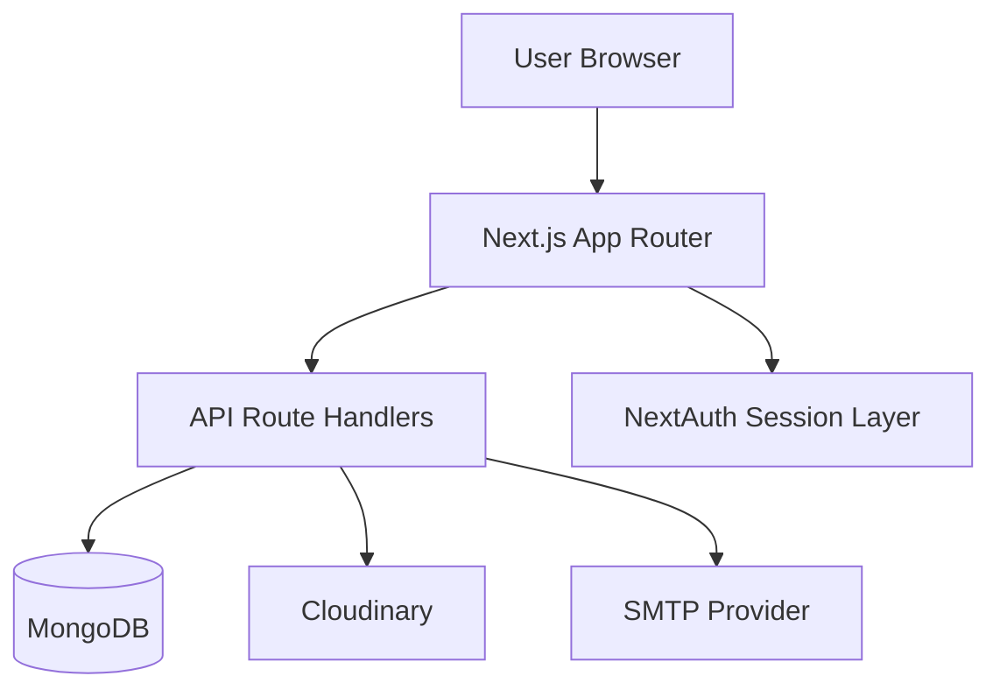

# 🏥 Aster Medicines

Production-ready Next.js platform for **Aster Medicines Pvt Ltd**, combining a premium public pharmaceutical website with a protected admin workspace for operations.

[](https://nextjs.org/)
[](https://react.dev/)
[](https://www.typescriptlang.org/)
[](https://mongoosejs.com/)
[](https://tailwindcss.com/)

---

## 📌 Table of Contents

- [Overview](#-overview)
- [Business Use Cases](#-business-use-cases)
- [Feature Matrix](#-feature-matrix)
- [Technology Stack](#-technology-stack)
- [System Architecture](#-system-architecture)
- [Request Lifecycle](#-request-lifecycle)
- [Project Structure](#-project-structure)
- [Local Development Setup](#-local-development-setup)
- [Environment Variables](#-environment-variables)
- [Scripts](#-scripts)
- [Routes & API Contracts](#-routes--api-contracts)
- [Auth & Access Control](#-auth--access-control)
- [Data Models](#-data-models)
- [SEO & Discoverability](#-seo--discoverability)
- [Security Notes](#-security-notes)
- [Deployment Checklist](#-deployment-checklist)
- [Operational Runbook](#-operational-runbook)
- [Troubleshooting](#-troubleshooting)
- [Contributing](#-contributing)
- [Support](#-support)

---

## 📖 Overview

This repository powers the official digital surface for Aster Medicines with two primary experiences:

1. **Public Experience**
   - Product discovery and detail pages
   - Inquiry/contact flow with optional image upload
   - SEO-ready metadata and schema rendering

2. **Internal Admin Experience**
   - Protected dashboard and product management
   - Message and visitor analytics monitoring
   - Global settings control (including maintenance mode)

The application uses the **Next.js App Router**, API route handlers, and **MongoDB/Mongoose** persistence.

---

## 🎯 Business Use Cases

### Marketing & lead generation
- Showcase formulations and product categories
- Collect structured inquiries from buyers/distributors
- Improve discovery via rich metadata and sitemap support

### Operations & governance
- Manage product records without redeploying
- Monitor website traffic sources and behavior
- Pause public traffic during maintenance windows while allowing admin access

### Support & continuity
- Reset admin credentials via email workflow
- Preserve centralized settings and contact touchpoints

---

## 🧩 Feature Matrix

| Area | Capability | Audience |
|------|------------|----------|
| Website | Home/About/Contact/Products pages | Public |
| Catalog | Category filtering + product detail route | Public |
| Inquiries | Form submissions with optional images | Public |
| Tracking | Visit logging with device/location metadata | Public + Admin insight |
| Auth | Credential-based session with NextAuth | Admin |
| Dashboard | Product CRUD, messages, visitor logs | Admin |
| Settings | Maintenance mode and site-level configurations | Admin |

---

## 🚀 Technology Stack

| Layer | Technology |
|------|------------|
| Framework | Next.js 16 (App Router) |
| Frontend | React 19 + Tailwind CSS + Radix UI |
| Language | TypeScript |
| Data | MongoDB + Mongoose |
| Auth | NextAuth.js |
| Validation/Form | Zod + React Hook Form |
| Motion | GSAP + Framer Motion |
| Notifications | Sonner |
| Email | Nodemailer (SMTP) |
| Uploads | Cloudinary |
| Device Parsing | ua-parser-js |

---

## 🏗️ System Architecture



### Key architectural characteristics
- **Single codebase** serving both public and admin surfaces.
- **Server-first routing** with API handlers under `src/app/api`.
- **Model-driven persistence** through Mongoose schemas.
- **External integration edges** for media upload and email delivery.

---

## 🔄 Request Lifecycle

### Public browse flow
1. User opens `/products`.
2. Frontend fetches product listing from `/api/products`.
3. API queries MongoDB and returns transformed product payload.
4. User navigates to `/products/[id]` for detailed view.

### Inquiry submission flow
1. User fills contact form.
2. Optional files are uploaded through `/api/upload`.
3. Contact payload is submitted to `/api/contact`.
4. Message is persisted and becomes visible in admin messages.

### Admin login flow
1. Admin opens obfuscated route `/7061452180`.
2. Credentials are validated via NextAuth handlers.
3. Session is established and protected admin routes unlock.

---

## 📂 Project Structure

```text
src/
├── app/                      # App Router pages + API handlers
│   ├── api/                  # auth, products, contact, settings, upload, track-visit
│   ├── admin/                # protected admin pages
│   ├── products/             # list + dynamic detail route
│   ├── maintenance/          # maintenance page
│   └── layout.tsx            # root app layout + metadata base
├── components/               # feature components and reusable UI
│   └── ui/                   # shared primitives
├── context/                  # global providers
├── hooks/                    # custom hooks
├── lib/                      # db, mail, shared server utilities
├── models/                   # mongoose schemas
├── services/                 # API client helper(s)
├── types/                    # type declarations
└── utils/                    # schema and animation helpers
```

---

## 🛠️ Local Development Setup

### Prerequisites
- Node.js **18.17+** (latest LTS recommended)
- npm
- MongoDB Atlas project (or local MongoDB)

### 1) Clone & install

```bash
git clone https://github.com/ADITYA0018TH/AsterMedicines1951-main-NEXT-JS.git
cd AsterMedicines1951-main-NEXT-JS
npm install --legacy-peer-deps
```

### 2) Configure environment

Create `.env.local` at project root and add required values.

### 3) Run development server

```bash
npm run dev
```

Open `http://localhost:3000`.

### 4) Lint before PR

```bash
npm run lint
```

---

## 🔐 Environment Variables

### Complete reference

| Variable | Required | Purpose |
|---------|----------|---------|
| `MONGODB_URI` | ✅ | Database connection URI |
| `NEXTAUTH_SECRET` | ✅ (prod) | Auth/session encryption secret |
| `NEXTAUTH_URL` | ✅ (prod) | Absolute app URL for NextAuth callbacks |
| `JWT_SECRET` | Optional fallback | Secondary auth secret fallback |
| `ADMIN_EMAIL` | ✅ | Admin credential email |
| `ADMIN_PASSWORD` | ✅ | Admin credential password |
| `SMTP_HOST` | ✅ (email flow) | SMTP server host |
| `SMTP_PORT` | ✅ (email flow) | SMTP server port |
| `SMTP_USER` | ✅ (email flow) | SMTP username |
| `SMTP_PASSWORD` | ✅ (email flow) | SMTP password/app password |
| `SMTP_FROM` | Optional | Outbound sender identity |
| `NEXT_PUBLIC_CLOUDINARY_CLOUD_NAME` | ✅ (uploads) | Cloudinary cloud name |
| `CLOUDINARY_API_KEY` | ✅ (uploads) | Cloudinary API key |
| `CLOUDINARY_API_SECRET` | ✅ (uploads) | Cloudinary API secret |
| `NEXT_PUBLIC_APP_URL` | Optional | Public base URL helper |
| `VERCEL_URL` | Auto | Runtime host on Vercel |

### Example `.env.local`

```env
MONGODB_URI=mongodb+srv://<user>:<pass>@cluster.mongodb.net/aster

NEXTAUTH_SECRET=replace_with_long_random_secret
NEXTAUTH_URL=http://localhost:3000
JWT_SECRET=replace_with_another_random_secret

ADMIN_EMAIL=admin@example.com
ADMIN_PASSWORD=change_this_now

SMTP_HOST=smtp.gmail.com
SMTP_PORT=587
SMTP_USER=mailer@example.com
SMTP_PASSWORD=app_password_here
SMTP_FROM="Aster Medicines <mailer@example.com>"

NEXT_PUBLIC_CLOUDINARY_CLOUD_NAME=your_cloud
CLOUDINARY_API_KEY=your_key
CLOUDINARY_API_SECRET=your_secret

NEXT_PUBLIC_APP_URL=http://localhost:3000
```

---

## 📜 Scripts

| Command | Description |
|---------|-------------|
| `npm run dev` | Start development server |
| `npm run build` | Build production bundle |
| `npm run start` | Start production server |
| `npm run lint` | Run ESLint checks |

---

## 🧭 Routes & API Contracts

### App Routes

| Route | Description |
|------|-------------|
| `/` | Home page |
| `/about` | About page |
| `/contact` | Contact/inquiry page |
| `/products` | Product listing |
| `/products/[id]` | Product detail |
| `/7061452180` | Admin login |
| `/admin/dashboard` | Admin overview |
| `/admin/products` | Product management |
| `/admin/messages` | Inquiry/message management |
| `/admin/visitors` | Visitor analytics |
| `/admin/settings` | Site settings |
| `/forgot-password` | Reset request |
| `/reset-password` | Reset completion |
| `/maintenance` | Maintenance splash page |

### API Endpoints

| Method | Endpoint | Purpose |
|-------|----------|---------|
| `GET` | `/api/products` | List products (supports `category`, `page`, `limit`) |
| `POST` | `/api/products` | Create product (single or bulk) |
| `GET` | `/api/products/[id]` | Fetch product by id |
| `PUT` | `/api/products/[id]` | Update product |
| `DELETE` | `/api/products/[id]` | Delete product |
| `GET` | `/api/categories` | List categories |
| `POST` | `/api/contact` | Save inquiry payload |
| `POST` | `/api/track-visit` | Save visitor tracking event |
| `POST` | `/api/upload` | Upload image assets |
| `GET / PUT` | `/api/settings` | Fetch/update settings |
| `GET / DELETE` | `/api/admin/visitors` | Fetch/delete visitor logs |
| `POST` | `/api/auth/forgot-password` | Generate reset token and mail |
| `POST` | `/api/auth/reset-password` | Reset password via token |
| `GET / POST` | `/api/auth/*` | NextAuth endpoint surface |

### API Examples

### List products by category

```http
GET /api/products?category=Antibiotics&page=1&limit=20
```

### Create product

```http
POST /api/products
Content-Type: application/json

{
  "name": "Azithromycin 500",
  "description": "Macrolide antibiotic tablet",
  "price": 120,
  "category": "Antibiotics",
  "images": ["https://..."],
  "stock": 100,
  "featured": true
}
```

### Visitor analytics query

```http
GET /api/admin/visitors?page=1&limit=50&excludeBots=true&search=india
```

---

## 🔐 Auth & Access Control

### Roles
- **Public**: can browse pages and submit inquiries.
- **Admin**: authenticated user with access to `/admin/*` and admin APIs.

### Access behavior summary
- Admin entry point is intentionally non-obvious: `/7061452180`.
- Session auth is managed with NextAuth credentials strategy.
- Password reset uses token + expiry fields on user records.
- Maintenance mode keeps admin/service routes usable while public routes redirect.

---

## 🗃️ Data Models

Core models in `src/models`:

- `Product`
  - Commercial + content fields: name, category, description, images, price, stock
  - Additional quality flags and detail attributes

- `Contact`
  - Inquiry metadata: name, email, phone, company, message, attachments

- `User`
  - Admin identity, hashed password, reset token/expiry lifecycle

- `Visitor`
  - Request metadata: path, ip, browser, os, location, timestamps, bot signals

- `Settings`
  - Site-level configuration including maintenance mode and contact config

---

## 🔎 SEO & Discoverability

- Dynamic metadata from App Router page surfaces
- Sitemap generation and robots route integration
- JSON-LD schema helpers for richer search engine understanding
- Product/detail route strategy designed for direct indexing

---

## 🔒 Security Notes

- NextAuth credential flow for controlled admin access
- `bcrypt` hashing for persisted passwords
- Admin-only route/API segregation
- Password reset token lifecycle with expiry
- Sensitive credentials isolated in environment variables

> Production recommendation: rotate secrets periodically and avoid weak defaults.

---

## ✅ Deployment Checklist

- [ ] All required environment variables set in target environment
- [ ] `NEXTAUTH_URL` matches final domain exactly
- [ ] MongoDB network + user permissions restricted
- [ ] SMTP validated with real mailbox test
- [ ] Cloudinary credentials validated (if uploads enabled)
- [ ] `npm run build` passes locally and in CI
- [ ] Core smoke test complete: login, product CRUD, contact, visitor logging

---

## 🧰 Operational Runbook

### Enable maintenance mode
1. Sign in as admin.
2. Open Settings page.
3. Toggle maintenance mode ON.
4. Validate public routes redirect to `/maintenance`.

### Verify post-deploy health
1. Open homepage and one product detail route.
2. Submit a contact inquiry.
3. Confirm message appears in admin.
4. Open visitor analytics and verify fresh visit entry.

### Recover admin access
1. Use Forgot Password flow.
2. Confirm reset email delivery.
3. Complete token-based reset.
4. Re-login and invalidate old sessions if needed.

---

## 🧯 Troubleshooting

### Login/session issues
- Validate `NEXTAUTH_SECRET` and `NEXTAUTH_URL`.
- Confirm system/server clocks are accurate.
- Clear browser cookies and re-authenticate.

### Mongo connection failures
- Re-check `MONGODB_URI` format and credentials.
- Ensure IP allowlist and cluster access rules are correct.
- Verify application user has read/write privileges.

### Password reset emails not sent
- Validate all `SMTP_*` values.
- Check provider restrictions/rate limits.
- For Gmail SMTP, ensure app password usage.

### Upload failures
- Confirm all Cloudinary variables are set and valid.
- Verify server-side API key/secret pair in deployment environment.

### Missing analytics rows
- Ensure `/api/track-visit` calls are not blocked by middleware or ad blockers.
- Confirm visitor records are not filtered out by current dashboard filters.

---

## 🤝 Contributing

1. Create a dedicated feature/fix branch.
2. Keep changes scoped and production-safe.
3. Run lint and basic manual checks.
4. Update docs for behavior/schema/API changes.
5. Open PR with summary + verification notes.

---

## 📬 Support

- Website: https://www.astermedicines.com
- Email: support@astermedicines.com

---

## 📝 Notes

- README state synced with repository on **2026-02-28**.
- If route contracts or env variables change, update this file in the same PR.